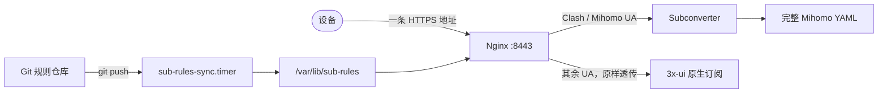

# sub-aggregator

> 给 3x-ui 加一层订阅聚合。一条地址同时服务 Clash/Mihomo 与 Shadowrocket/v2rayN，自维护的规则集本机托管、本机发布。

[](LICENSE)
[](https://github.com/MHSanaei/3x-ui)
[](https://github.com/MetaCubeX/mihomo)
[](docs/sub/README.md)

## 它解决什么

3x-ui 的原生订阅是一串 Base64 编码的节点，Clash 客户端不认。第三方转换服务能把格式对上，但转换和规则集都落在别人的服务器上，服务停不停、规则什么时候更新，你控制不了。同一个人的手机和电脑还常常各配一条订阅，换个客户端就要重新找地址。

这个项目把这两件事收回本机。设备只记一条 HTTPS 地址，Nginx 按 `User-Agent` 决定返回 Clash YAML 还是原生订阅原文。自维护的规则集由 systemd 定时器从 Git 发布到 Nginx 直接 serve 的目录，push 后最多一分钟生效，中间没有 CDN 缓存。

## 架构

一条订阅地址，两条互不依赖的链路：



订阅链路由 Nginx 和本机 subconverter 组成，规则链路是一条独立的 Git 发布管道。只装订阅入口也能用，规则集可以以后再加。图中画的是自维护的两个 list；ACL4SSR 的 9 个上游规则集按天更新，仍走 jsdelivr，不在这条链路里。

## 特性

- **一条地址两用**：同一个 URL 按 `User-Agent` 分流，Clash 家族拿完整 Mihomo YAML，其余客户端拿原生订阅原文。`?t=clash` / `?t=raw` 可以强制指定，认不出 UA 时落到原生分支。
- **订阅路径即凭据**：每条订阅一条含 48 位随机 hex 的 HTTPS 地址。`sub-manager rotate` 换路径即作废旧地址，订阅编号和源订阅都不变。
- **与 3x-ui 只读联动**：`add --from-xui` 从面板客户端列表里挑人，原始订阅地址由 `subId` 推导。脚本对 x-ui、xray 和任何 `*.db` 零写操作。
- **节点名保持恒定**：转换参数剥掉 3x-ui 追加的 `|📊<剩余流量>`，更新订阅后 Mihomo 仍能还原你手动选择的节点。
- **规则集自托管**：自维护的 [ChinaDirect.list 和 Reject.list](https://github.com/DuskWander87/shadowrocket-config) 从 Git 发布到本机目录，Nginx 直接 serve，不经过 jsdelivr 或 GitHub 缓存。发布目录缺文件时才落到 GitHub 反代兜底。
- **低配友好**：无 Docker、无外部配置托管，2 GB 内存够用，端口避开 Xray Reality 占用的 443。
- **每一步都能自证**：`sub-manager test` 对每条订阅发四种 UA 做端到端断言，`sub-rules-check` 核对端点、发布目录、git 副本和 origin 四处一致。

## 快速开始

前提：一台跑着 3x-ui 的 Ubuntu 服务器，443 上有一个可用的 VLESS Reality 入站；一个指向它的域名（缺证书时脚本自动签发）；root 权限和至少 2 GB 内存。

在仓库根目录执行一条命令：

```bash
git clone https://github.com/DuskWander87/sub-aggregator.git
cd sub-aggregator
tools/deploy.sh
```

脚本自动推导域名和证书（缺证书时用 Let's Encrypt 签发，续期由 acme.sh 自动完成，见
[certificates.md](docs/sub/certificates.md)），缺失依赖会先确认安装；打印摘要后确认一次即
完成部署，覆盖前先备份。想先预览加 `--dry-run`（只读，不改任何文件）。参数、手动步骤、
规则链和回滚见 [deploy.md](docs/sub/deploy.md)。

不想再用了就跑 `tools/uninstall.sh`。它会先打印计划再等确认，只删聚合层，3x-ui、节点、
证书和 Nginx 本身不动。

规则链是可选步骤。加 `--with-rules` 启用，默认使用作者的 [规则集](https://github.com/DuskWander87/shadowrocket-config)；想自己维护就 fork 后传 `--rules-repo`。

## 日常操作

```bash
sub-manager list              # 订阅、客户端归属、双向漂移
sub-manager update sub-1      # 源订阅 subId 变了，地址不变
sub-manager rotate sub-1      # 换路径，编号和源订阅不变
sub-manager remove sub-1      # 撤销
sub-rules-check               # 规则链四处一致性
```

面板增删客户端不会自动改动聚合地址。加人之后要再跑一次 `sub-manager add --from-xui`，`list` 会报告两边的漂移。

改了 `base/all_base.tpl` 或 `snippets/*.txt` 之后，先重启再 resync，因为 `cache_config=300` 会缓存模板：

```bash
systemctl restart subconverter && sub-manager resync
```

## 它不是什么

- 不是带界面的管理面板。部署脚本一条命令完成，默认打印摘要后确认一次；日常操作走 `sub-manager` 命令行。
- 不修改 3x-ui、Xray 或 443 上的 VLESS Reality 入站。它只在旁边新增 Nginx 入口和一个只监听回环地址的 subconverter。
- 不是多租户服务。每条订阅对应一个 3x-ui 客户端，没有账号体系，也没有配额。
- 不提供高可用。单机、单 Nginx、单 subconverter，适合个人或小圈子。

## 仓库结构

```text
server/            真机配置的脱敏拷贝，靠人手工同步
  sbin/            sub-manager、sub-rules-sync、sub-rules-check
  nginx/           订阅入口片段、规则端点、缓存区
  subconverter/    pref.ini、Mihomo 模板、自维护 snippets
  systemd/         转换后端与规则同步单元
tools/             部署 deploy.sh、卸载 uninstall.sh、沙箱自测 selftest.sh
docs/              中文运维文档
  sub/             订阅聚合服务：部署、订阅入口、设计、操作、故障记录
  3x-ui/           3x-ui / Reality 底座：故障排查归档
```

## 文档

| 文档 | 什么时候读 |
|---|---|
| [docs/sub/README.md](docs/sub/README.md) | 找入口、查常量（端口、路径、`CONVERT_OPTS` 的单一事实源） |
| [deploy.md](docs/sub/deploy.md) | 第一次安装、重装或卸载：前提、脚本、手动步骤、回滚 |
| [certificates.md](docs/sub/certificates.md) | 证书给谁用、续期链路、能不能不用 acme.sh |
| [design.md](docs/sub/design.md) | 要改系统，先看设计取舍 |
| [unified-subscription.md](docs/sub/unified-subscription.md) | 给设备配订阅，或要改 UA 分流规则 |
| [operations.md](docs/sub/operations.md) | 管理脚本、轮换撤销、检查与验证、备份 |
| [incidents.md](docs/sub/incidents.md) | 「这个症状以前见过吗」 |
| [3x-ui/troubleshooting.md](docs/3x-ui/troubleshooting.md) | 节点不通时，一次完整排查全过程 |

## 安全与边界

- **订阅地址就是凭据**。随机路径泄露后，持有者可以更新这份订阅。`rotate` 会换发新路径。
- **换路径不等于踢人**。轮换或删除只作废配置分发通道。客户端已经拉到的配置不会消失，里面的 VLESS UUID 仍然有效。要真正收回访问，去 3x-ui 面板删掉或更换该客户端的 UUID。
- **仓库不含真实凭据**。域名、随机路径、证书路径一律是占位符。但它描述了一台真实机器的架构细节，请把它当参考蓝图，不要当安全承诺。

## 许可与致谢

[MIT](LICENSE) © 2026 DuskWander。建立在 [3x-ui](https://github.com/MHSanaei/3x-ui)、[subconverter](https://github.com/tindy2013/subconverter) 与 [Mihomo](https://github.com/MetaCubeX/mihomo) 之上。
